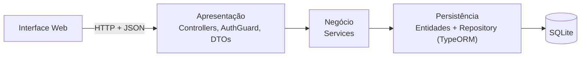

# Arquitetura e Camada de Persistência

Apresentação da arquitetura do Sistema de Moeda Estudantil e da sua camada de persistência, conforme o código atual. Hoje estão implementados a autenticação e os CRUDs de aluno e de empresa parceira.

## Tecnologias

| Parte | Tecnologia |
| --- | --- |
| Frontend | HTML, CSS e JavaScript puro, consumindo a API com `fetch` |
| Backend | NestJS + TypeScript (API REST) |
| Persistência | TypeORM + SQLite (`better-sqlite3`) |
| Segurança | JWT e hash de senha com bcrypt |
| Testes | Vitest + Supertest |

## Arquitetura em camadas

O backend segue o [diagrama de componentes](diagramas/diagrama_de_componentes.png): cada camada só conversa com a camada logo abaixo.

| Camada | Responsabilidade |
| --- | --- |
| Apresentação | Recebe a requisição, exige o token JWT (exceto nas rotas `@Public()`) e valida os dados de entrada com DTOs |
| Negócio | Aplica as regras das histórias de usuário: dados únicos, hash de senha, cada usuário só edita o próprio cadastro |
| Persistência | Mapeia as classes para tabelas e executa as consultas; os services não escrevem SQL |

Cada funcionalidade é um módulo do NestJS (`alunos/`, `empresas/`, `usuarios/`, `instituicoes/`, `auth/`) com o seu controller, service, entidade e DTOs.

## Camada de persistência

### Configuração

O TypeORM é configurado em `app.module.ts` com o SQLite embarcado: o banco é um arquivo local (`moeda.sqlite`), sem servidor para instalar. Com `synchronize: true`, as tabelas são criadas a partir das entidades. Nos testes, o banco roda em memória (`:memory:`) e começa vazio a cada caso.

O acesso segue o padrão **Data Mapper**: as entidades só descrevem as tabelas, e quem lê e grava é o `Repository<T>` do TypeORM, injetado em cada service.

### Modelo de dados

O banco segue o [modelo entidade-relacionamento](diagramas/modelo-entidade-relacionamento.puml). Estão implementadas as tabelas `usuario`, `instituicao`, `aluno` e `empresa_parceira`. As tabelas `professor`, `vantagem`, `envio_moedas`, `resgate` e `credito_semestral` estão planejadas.

**Herança de usuário:** login, senha e email ficam na tabela `usuario`. Cada perfil (aluno, professor, empresa) fica em uma tabela própria, ligada a `usuario` em 1:1, e a chave primária do perfil é a própria chave estrangeira. Assim, o login é único entre todos os tipos de usuário, a autenticação consulta só uma tabela e cada perfil tem as suas próprias colunas obrigatórias.

### Transações

O cadastro, a edição e a exclusão gravam em `usuario` e no perfil dentro de uma única transação (`dataSource.transaction`). Se algum passo falhar, nada é gravado, e nunca fica um usuário sem perfil.

### Integridade e segurança

- **No banco:** `UNIQUE` em login, email, CPF e CNPJ; chaves estrangeiras obrigatórias; saldo inicial `DEFAULT 0`.
- **Na aplicação:** CPF e CNPJ têm os dígitos verificadores conferidos e são gravados só com os dígitos. Login e CPF não podem ser alterados. Duplicados retornam 409, com mensagem clara.
- **Senha:** gravada só como hash bcrypt e nunca devolvida pela API (`@Exclude()`).

## Próximos passos

- Implementar as tabelas planejadas: professor, vantagens, envio de moedas, resgate e crédito semestral.
- Trocar `synchronize` por migrations antes de usar em produção.
