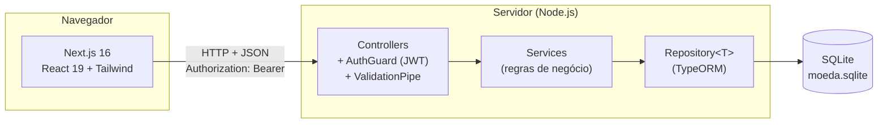

# Tutorial das Tecnologias — Sistema de Moeda Estudantil

Tutorial das tecnologias usadas na Release 1 do Sistema de Moeda Estudantil, preparado para o salão de tecnologias (Lab03S03) e para o grupo avaliador do Projeto V.

Cada tecnologia segue a mesma estrutura: **o que é**, **por que escolhemos**, **demonstração prática** (com código real do repositório) e **dificuldades que encontramos**.

## Sumário

1. [Visão geral da stack](#1-visão-geral-da-stack)
2. [Rodando o projeto em 5 minutos](#2-rodando-o-projeto-em-5-minutos)
3. [NestJS](#3-nestjs)
4. [TypeORM + SQLite](#4-typeorm--sqlite)
5. [class-validator (validação de entrada)](#5-class-validator-validação-de-entrada)
6. [JWT + bcrypt (autenticação)](#6-jwt--bcrypt-autenticação)
7. [Next.js](#7-nextjs)
8. [Tailwind CSS](#8-tailwind-css)
9. [Vitest + Supertest (testes)](#9-vitest--supertest-testes)
10. [Arquitetura e camada de persistência](#10-arquitetura-e-camada-de-persistência)
11. [Roteiro da demonstração ao vivo](#11-roteiro-da-demonstração-ao-vivo)

---

## 1. Visão geral da stack



| Camada | Tecnologia | Versão |
| --- | --- | --- |
| Frontend | Next.js (App Router) + React + TypeScript | 16.4 / 19.3 / 5 |
| Estilo | Tailwind CSS + ícones lucide-react | 4 |
| Backend | NestJS + TypeScript | 12 / 6 |
| Persistência | TypeORM + SQLite (`better-sqlite3`) | 1.1 / 12 |
| Validação | class-validator + class-transformer | 0.15 |
| Segurança | JWT (`@nestjs/jwt`) + bcrypt | 12 / 6 |
| Testes | Vitest + Supertest | 4 / 7 |

O mesmo idioma (TypeScript) roda no frontend e no backend. Esse foi o principal motivo da troca de stack descrita na [seção 3](#dificuldades-encontradas).

---

## 2. Rodando o projeto em 5 minutos

Pré-requisito: **Node.js 20 ou superior** (testado com o 24). Não é preciso instalar banco de dados.

```bash
# Terminal 1 — API em http://localhost:3000
cd src/backend
npm install
npm run start:dev

# Terminal 2 — interface em http://localhost:3001
cd src/frontend
npm install
npm run dev
```

Abra `http://localhost:3001`, clique em **Cadastrar como aluno** e crie uma conta. As instituições de ensino (PUC Minas, UFMG, CEFET-MG) são criadas automaticamente na primeira execução.

> Para começar com o banco vazio a cada reinício, rode o backend com `DB_DATABASE=":memory:" npm run start:dev`.

---

## 3. NestJS

### O que é

Framework para construir APIs em Node.js com TypeScript. Organiza o código em **módulos**, cada um com **controllers** (rotas HTTP), **providers/services** (regras de negócio) e **injeção de dependências**, no mesmo estilo do Spring Boot.

### Por que escolhemos

- **MVC e camadas prontas:** o enunciado exige MVC, e o Nest já separa controller, service e entidade. Isso bate com o nosso [diagrama de componentes](diagramas/diagrama_de_componentes.png).
- **TypeScript no projeto inteiro:** os tipos usados na API (`Aluno`, `EmpresaParceira`) são os mesmos que o frontend consome.
- **Decorators declarativos:** validação (`@IsEmail()`), rotas (`@Get()`) e segurança (`@Public()`) ficam visíveis em cima de cada método.

### Demonstração prática

Um controller completo do CRUD de aluno (`src/backend/src/alunos/alunos.controller.ts`, resumido):

```ts
@Controller('alunos')
export class AlunosController {
  // O Nest injeta o service automaticamente (injeção de dependências).
  constructor(private readonly alunosService: AlunosService) {}

  @Public()            // cadastro não exige login
  @Post()
  criar(@Body() dto: CreateAlunoDto) {
    return this.alunosService.criar(dto);
  }

  @Get(':id')
  buscar(@Param('id', ParseIntPipe) id: number) {
    return this.alunosService.buscar(id);
  }

  @Patch(':id')
  atualizar(
    @Param('id', ParseIntPipe) id: number,
    @Body() dto: UpdateAlunoDto,
    @UsuarioLogado() usuario: UsuarioAutenticado, // vem do token JWT
  ) {
    return this.alunosService.atualizar(id, dto, usuario);
  }
}
```

O controller não tem regra de negócio: ele recebe a requisição já validada e delega ao service. A regra "cada aluno só edita o próprio cadastro" fica no service:

```ts
private garantirProprioAluno(id: number, usuario: UsuarioAutenticado) {
  if (usuario.tipo !== TipoUsuario.ALUNO || usuario.id !== id) {
    throw new ForbiddenException('Você só pode alterar o seu próprio cadastro.');
  }
}
```

**Teste rápido:**

```bash
curl http://localhost:3000/instituicoes
# [{"id":3,"nome":"CEFET-MG"},{"id":1,"nome":"PUC Minas"},...]
```

Exceções como `ForbiddenException` viram automaticamente respostas HTTP com status e JSON (403 neste caso), sem `try/catch` no controller.

### Dificuldades encontradas

- **Migração de Spring Boot para NestJS.** O projeto começou em Spring Boot (commit `b9d49fc`). Na Sprint 2 migramos para NestJS, porque o grupo tem mais familiaridade com TypeScript e queríamos uma linguagem só no front e no back. Os conceitos (controller, service, repository, injeção de dependências) se traduziram quase um para um.
- **ES Modules.** Com `"type": "module"` no `package.json`, os imports internos precisam terminar em `.js` mesmo nos arquivos `.ts` (`import { AlunosService } from './alunos.service.js'`). Esquecer a extensão compila, mas falha ao executar.
- **Guard global.** Registramos o `AuthGuard` para *todas* as rotas e criamos o decorator `@Public()` para as exceções (login e cadastros). É mais seguro do que lembrar de proteger cada rota, mas no começo esquecemos o `@Public()` no cadastro e ninguém conseguia se registrar.

---

## 4. TypeORM + SQLite

### O que é

**TypeORM** é um ORM (Object-Relational Mapper) para TypeScript: classes com decorators viram tabelas, e as consultas são feitas com objetos, sem SQL escrito à mão. **SQLite** é um banco relacional embarcado: o banco inteiro é um arquivo (`moeda.sqlite`), sem servidor para instalar.

### Por que escolhemos

- **ORM em vez de DAO manual:** o enunciado pede uma estratégia de acesso a dados. Com o padrão *Data Mapper* do TypeORM, as entidades só descrevem as tabelas e o `Repository<T>` faz a leitura e a gravação. Isso dá o mesmo isolamento de um DAO, sem escrever o DAO.
- **SQLite para o protótipo:** qualquer pessoa clona o repositório e roda com `npm install`, sem Docker nem PostgreSQL. Nos testes, o banco roda em memória (`:memory:`).
- **Integração nativa com o Nest** (`@nestjs/typeorm`), com repositórios injetáveis.

### Demonstração prática

**1. Entidade = tabela** (`src/backend/src/alunos/aluno.entity.ts`, resumida):

```ts
@Entity('aluno')
export class Aluno {
  @PrimaryColumn({ name: 'usuario_id' })   // PK que também é FK para "usuario"
  id: number;

  @OneToOne(() => Usuario, { eager: true, onDelete: 'CASCADE' })
  @JoinColumn({ name: 'usuario_id' })
  usuario: Relation<Usuario>;              // login, senha e email ficam em "usuario"

  @ManyToOne(() => Instituicao, { eager: true, nullable: false })
  @JoinColumn({ name: 'instituicao_id' })
  instituicao: Relation<Instituicao>;

  @Column({ length: 11, unique: true })
  cpf: string;

  @Column({ type: 'integer', default: 0 }) // todo aluno começa com 0 moedas
  saldo: number;
}
```

**2. Configuração** (`app.module.ts`): `synchronize: true` cria as tabelas a partir das entidades.

```ts
TypeOrmModule.forRoot({
  type: 'better-sqlite3',
  database: 'moeda.sqlite',
  autoLoadEntities: true,
  synchronize: true, // só em desenvolvimento
});
```

**3. Transação:** o cadastro grava em duas tabelas, `usuario` e `aluno`. Se a segunda gravação falhar, a primeira é desfeita:

```ts
const id = await this.dataSource.transaction(async (manager) => {
  if (await manager.existsBy(Aluno, { cpf: dto.cpf })) {
    throw conflito('cpf', 'Já existe um aluno cadastrado com este CPF.');
  }
  const usuario = await this.usuariosService.criar(manager, dto, TipoUsuario.ALUNO);
  await manager.insert(Aluno, { id: usuario.id, instituicao, nome: dto.nome, cpf: dto.cpf, /* ... */ });
  return usuario.id;
});
```

**Teste rápido:** depois de cadastrar um aluno pela interface, abra o banco:

```bash
cd src/backend
node -e "const db=require('better-sqlite3')('moeda.sqlite');console.table(db.prepare('select id, login, tipo_usuario, senha from usuario').all())"
```

A senha aparece apenas como hash bcrypt (`$2b$10$...`).

### Dificuldades encontradas

- **Herança de usuário.** Aluno, professor e empresa têm login e senha, mas colunas diferentes. Testamos *single table* (uma tabela com tudo e várias colunas nulas) e escolhemos **tabela por perfil ligada a `usuario` em 1:1**. Detalhes em [camada-persistencia-arquitetura.md](camada-persistencia-arquitetura.md).
- **`synchronize` apaga colunas.** Ao renomear um campo da entidade, o TypeORM remove a coluna antiga junto com os dados. Em produção isso precisa ser trocado por *migrations*.
- **Relações `eager`.** Sem `eager: true`, `aluno.usuario` vinha `undefined` e o frontend quebrava ao ler `aluno.usuario.email`.

---

## 5. class-validator (validação de entrada)

### O que é

Biblioteca de validação por decorators. Junto com o `ValidationPipe` do Nest, ela valida o corpo de cada requisição **antes** de o controller ser chamado.

### Por que escolhemos

É a solução padrão do NestJS: as regras ficam no DTO, ao lado de cada campo, e valem para toda a API.

### Demonstração prática

**DTO com mensagens em português** (`create-aluno.dto.ts`, resumido):

```ts
export class CreateAlunoDto {
  @IsEmail({}, { message: 'Informe um email válido.' })
  email: string;

  @IsString({ message: 'Informe a senha.' })
  @MinLength(6, { message: 'A senha deve ter pelo menos 6 caracteres.' })
  senha: string;

  @IsCpf()  // decorator próprio: remove a máscara e confere os dígitos verificadores
  cpf: string;
}
```

**Erros por campo.** Criamos um `exceptionFactory` (`src/backend/src/common/erros.ts`) que devolve, além da lista de mensagens, **qual campo** está errado. Assim o frontend mostra o erro embaixo do input certo:

```bash
curl -X POST http://localhost:3000/alunos -H "Content-Type: application/json" \
  -d '{"login":"ana","senha":"123","email":"x","cpf":"111", ...}'
```

```json
{
  "statusCode": 400,
  "message": ["A senha deve ter pelo menos 6 caracteres.", "Informe um email válido.", "CPF inválido: confira os dígitos."],
  "campos": {
    "senha": "A senha deve ter pelo menos 6 caracteres.",
    "email": "Informe um email válido.",
    "cpf": "CPF inválido: confira os dígitos."
  }
}
```

Dados duplicados (login, email, CPF, CNPJ) seguem o mesmo formato com status **409**.

### Dificuldades encontradas

- As mensagens padrão vêm em inglês (`email must be an email`). Precisamos escrever `message` em cada decorator.
- `whitelist` + `forbidNonWhitelisted` rejeitam campos desconhecidos. Usamos isso a nosso favor: como `UpdateAlunoDto` omite `login` e `cpf`, enviar esses campos no PATCH retorna 400, e eles se tornam imutáveis sem nenhum `if`.

---

## 6. JWT + bcrypt (autenticação)

### O que é

- **bcrypt:** função de hash lenta e com *salt*, feita para guardar senhas. Nem quem tem acesso ao banco consegue recuperar a senha original.
- **JWT (JSON Web Token):** token assinado pelo servidor que carrega a identidade do usuário (`id`, `login`, `tipo`). O cliente envia o token em cada requisição, e o servidor confere a assinatura sem consultar sessão no banco.

### Por que escolhemos

O enunciado exige login e senha para alunos, professores e empresas. JWT funciona bem com uma API REST consumida por um frontend separado, e o `tipo` dentro do token permite liberar ou bloquear ações por perfil.

### Demonstração prática

```bash
# 1. Login devolve o token
curl -X POST http://localhost:3000/auth/login -H "Content-Type: application/json" \
  -d '{"login":"ana","senha":"123456"}'
# {"accessToken":"eyJhbGciOi...","tipo":"ALUNO"}

# 2. O token identifica o usuário
curl http://localhost:3000/auth/me -H "Authorization: Bearer eyJhbGciOi..."
# {"id":1,"login":"ana","tipo":"ALUNO"}

# 3. Sem token, a rota é bloqueada
curl http://localhost:3000/alunos
# {"message":"Faça login para continuar.","statusCode":401}
```

Trecho do guard global (`auth.guard.ts`):

```ts
const [esquema, token] = request.headers.authorization?.split(' ') ?? [];
if (esquema !== 'Bearer' || !token) {
  throw new UnauthorizedException('Faça login para continuar.');
}
const payload = await this.jwtService.verifyAsync(token);
request.usuario = { id: payload.sub, login: payload.login, tipo: payload.tipo };
```

A senha nunca sai da API: a coluna tem `@Exclude()`, e o `ClassSerializerInterceptor` remove o campo de todas as respostas.

### Dificuldades encontradas

- **Segredo do token.** Em desenvolvimento, o segredo tem um valor padrão. Em produção, ele deve vir da variável `JWT_SECRET` (veja `src/backend/.env.example`).
- **Token expirado no frontend.** Quando a API responde 401, o frontend apaga a sessão, avisa "Sua sessão expirou" e, depois do novo login, volta para a página em que o usuário estava.

---

## 7. Next.js

### O que é

Framework React com roteamento baseado em pastas, renderização no servidor e build otimizado. Usamos o **App Router** (pasta `app/`) do Next.js 16.

### Por que escolhemos

A primeira versão do frontend (Sprint 2) era HTML + JavaScript puro, com o menu montado via `innerHTML` em cada página. Isso funcionava, mas:

- cada página repetia o mesmo código de sessão, menu e mensagens;
- não havia componentes reutilizáveis para campos com erro, diálogos e avisos;
- não havia checagem de tipos entre o que a API devolve e o que a tela usa.

Com o Next.js, ganhamos componentes React, TypeScript, rotas por pasta e *layouts* compartilhados, sem configurar bundler.

### Demonstração prática

**Rotas por pasta.** Os parênteses criam *route groups*: organizam o código sem aparecer na URL.

```
app/
├── layout.tsx              → cabeçalho + provedores (em todas as páginas)
├── page.tsx                → /            (página inicial)
├── (publico)/layout.tsx    → só para quem NÃO está logado
│   ├── login/              → /login
│   └── cadastro/aluno/     → /cadastro/aluno
└── (area)/layout.tsx       → exige login em todas as páginas abaixo
    ├── painel/             → /painel
    ├── alunos/             → /alunos
    ├── empresas/           → /empresas
    └── perfil/             → /perfil
```

**Proteção de rotas por layout.** Uma linha protege a área logada inteira:

```tsx
// app/(area)/layout.tsx
export default function LayoutArea({ children }: LayoutProps<"/">) {
  return <ExigirLogin>{children}</ExigirLogin>;
}

// app/(area)/perfil/page.tsx — além de logado, precisa ser aluno ou empresa
<ExigirLogin tipos={["ALUNO", "EMPRESA"]}>
  <ConteudoPerfil />
</ExigirLogin>
```

**Permissões visíveis na interface.** A tela de alunos só mostra *editar/excluir* na linha do próprio usuário, e oculta o CPF e o saldo dos outros:

```tsx
const proprio = ehAluno && aluno.id === usuario?.id;
// ...
<td>{proprio ? formatarCpf(aluno.cpf) : ocultarCpf(aluno.cpf)}</td>
{proprio && <ExcluirConta usuario={usuario} compacto />}
```

**Formulário com erros da API no campo certo** (`components/use-formulario.ts`):

```tsx
const form = useFormulario(VAZIO, validarAluno);
// ...
<Campo rotulo="CPF" obrigatorio {...form.ligar("cpf", mascararCpf)} />
// ...
try {
  await requisitar("/alunos", { method: "POST", body: dados });
} catch (erro) {
  form.mostrarErroDaApi(erro); // lê "campos" da resposta e marca cada input
}
```

**Teste rápido:** com a API rodando, acesse `http://localhost:3001/painel` sem estar logado. O sistema leva para `/login` e, depois do login, volta ao painel.

### Dificuldades encontradas

- **Next.js 16 mudou bastante.** O projeto vem com `cacheComponents` ativado: as páginas são pré-renderizadas como um "esqueleto" estático, e as rotas visitadas ficam montadas em segundo plano (`<Activity>`), mantendo o estado ao voltar. Lemos a documentação que vem em `node_modules/next/dist/docs/` antes de escrever o código, porque vários exemplos da internet são de versões anteriores.
- **Sessão no `localStorage` x pré-renderização.** No servidor não existe `localStorage`. Ler o token direto no render causava *hydration mismatch*. Resolvemos com `useSyncExternalStore`, que devolve `null` no servidor e o valor real no navegador (`components/auth.tsx`).
- **Aviso de "instant navigation".** No começo, os guards não renderizavam a página enquanto verificavam a sessão, e o Next avisava que não conseguia validar o segmento. A solução foi sempre renderizar a página, escondida (`<div hidden>`), até a sessão ser confirmada, e fazer as buscas esperarem o login.
- **CORS e duas portas.** A API roda na porta 3000 e o Next na 3001. O backend usa `app.enableCors()`. A URL da API vem de `NEXT_PUBLIC_API_URL`.

---

## 8. Tailwind CSS

### O que é

Framework de CSS utilitário: em vez de escrever classes próprias num arquivo `.css`, cada elemento recebe classes pequenas (`rounded-lg`, `text-sm`, `bg-indigo-600`).

### Por que escolhemos

Vem integrado ao `create-next-app`, deixa o visual consistente sem um CSS de centenas de linhas e facilita a versão responsiva (prefixos `sm:`, `md:`).

### Demonstração prática

O componente `Campo` (`components/ui.tsx`) muda a cor da borda quando há erro e mostra o asterisco nos campos obrigatórios:

```tsx
<input
  className={`w-full rounded-lg border px-3 py-2 text-sm ${
    erro ? "border-rose-400 focus:ring-rose-100"
         : "border-slate-300 focus:ring-indigo-100"
  }`}
/>
```

Responsividade em uma classe: `hidden md:table-cell` esconde a coluna de email da tabela no celular.

### Dificuldades encontradas

As listas de classes ficam longas. Para não repetir, extraímos componentes (`Botao`, `Campo`, `Cartao`, `Alerta`) em vez de copiar classes entre páginas.

---

## 9. Vitest + Supertest (testes)

### O que é

- **Vitest:** executor de testes rápido, compatível com a API do Jest.
- **Supertest:** faz requisições HTTP reais contra a aplicação Nest em memória.

### Por que escolhemos

Os testes *end-to-end* sobem a API completa (guard, validação, banco SQLite em memória) e verificam o que o frontend recebe de verdade.

### Demonstração prática

```ts
it('rejeita CPF, email ou login duplicados', async () => {
  await http().post('/alunos').send(alunoValido).expect(201);
  await http()
    .post('/alunos')
    .send({ ...alunoValido, login: 'outro', email: 'outro@email.com' })
    .expect(409); // mesmo CPF
});
```

```bash
cd src/backend
npm test           # unitários: validação de CPF e CNPJ (6 testes)
npm run test:e2e   # ponta a ponta: CRUD de aluno e empresa (20 testes)
```

### Dificuldades encontradas

Cada teste precisa começar com o banco vazio. Usamos `DB_DATABASE=':memory:'` e recriamos a aplicação no `beforeEach`.

---

## 10. Arquitetura e camada de persistência

A apresentação da arquitetura em camadas, do modelo de dados (herança de usuário, transações, integridade) e das decisões técnicas está em **[camada-persistencia-arquitetura.md](camada-persistencia-arquitetura.md)**. Os diagramas ficam em [`docs/diagramas/`](diagramas/).

---

## 11. Roteiro da demonstração ao vivo

Sugestão de roteiro para os ~20 minutos do salão de tecnologias:

| Tempo | O que mostrar | Tecnologia |
| --- | --- | --- |
| 0–3 min | Visão geral (seção 1) e por que trocamos Spring por Nest | — |
| 3–6 min | `npm run start:dev` + `curl /instituicoes` + controller de aluno | NestJS |
| 6–9 min | Entidade `Aluno`, transação do cadastro, `.tables` no SQLite | TypeORM |
| 9–12 min | `curl` com dados inválidos mostrando `campos` + DTO | class-validator |
| 12–16 min | Na interface: cadastro com CPF inválido → erro no campo; cadastro válido → painel | Next.js + Tailwind |
| 16–18 min | Entrar como empresa em outra janela: CPF mascarado, sem botões de edição | JWT + permissões |
| 18–20 min | `npm run test:e2e` e perguntas | Vitest |
